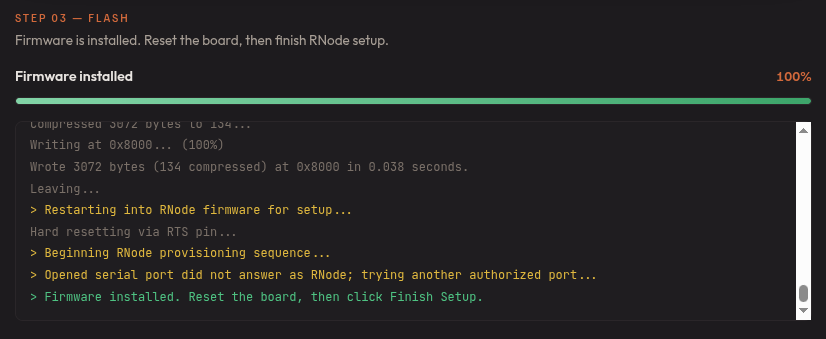
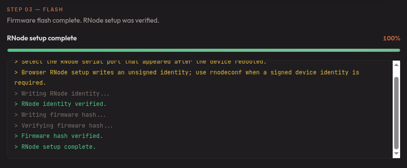

# Flash upstream RNode on Heltec LoRa32

The **RNode** tab on the Ratspeak advanced flasher installs
[upstream RNode firmware](https://github.com/markqvist/RNode_Firmware).
Your Heltec then serves as a radio for Ratspeak or another Reticulum host.
This procedure uses the **RNode** tab; the separately labelled **rsNode** tab
is a private beta and has its own access and installation instructions.

Upstream marks its Heltec firmware experimental. Check your exact board revision
and radio band against the available variants before installing.

## Preparation

Use Chrome or Edge on a computer, a USB data cable, and an antenna suited to the
board's frequency band. Attach the antenna before transmitting. Close other
applications using the serial port.

Save any existing firmware's configuration and identity using its backup
instructions. **Full Erase** deletes the device's internal contents. Do not
turn it on simply because you are following this tutorial; use it only for a
deliberate fresh installation or when the installer requires it and your backup
is complete.

## Choose the firmware

1. Open the [Ratspeak advanced flasher](https://ratspeak.org/flash.html). From
   the download page, select **Open the advanced flasher**.
2. Connect the board by USB. Select **Select USB device** and choose its port.
3. Under **Choose firmware**, select the **RNode** tab. Choose a **Firmware release**,
   the exact **Device variant**, and its **Hardware band**. If your variant is
   absent, stop rather than selecting a nearby model.
4. Check the selected board and band in the ready message. Under **Advanced
   options**, leave **RNode setup** enabled so the installer can provision and
   verify the radio.

The browser setup writes an unsigned RNode device identity. If you require a
signed device identity, use the [rnodeconf procedure](/tutorials/flashing-from-source/heltec-lora32).
This device identity is separate from your Ratspeak messaging identity.

## Flash and finish setup

1. Select **Install firmware**. Review any erase notice before continuing.
   Keep the USB cable connected and the tab open.
2. Wait for both firmware writing and RNode setup to finish. **Flash written**
   alone is not confirmation that provisioning succeeded; wait for **Firmware installed**.
3. If the page says **Firmware is installed. Reset the board, then finish RNode
   setup**, press **RST**. When its serial port returns, choose **Finish Setup**
   and select the port if asked.
4. Wait for **RNode setup complete** and the message that setup was verified.
   If setup fails, keep the log and follow its error before trying another flash.

If the board cannot enter the flasher, use
[Heltec's bootloader instructions](https://wiki.heltec.org/docs/platform/f%26t/flash):
hold **USER/PRG**, press and release **RST**, then release USER/PRG. The port may
change. Use the board labels or its manual rather than assuming which button is
on the left or right.

## Connect to Ratspeak

Close the flasher so it releases the serial port. Add an RNode interface in
Ratspeak, match the radio settings to a known peer, announce and exchange a
message. Follow [LoRa and RNode](/docs/networking/lora-and-rnode) for those steps.

For help, include the board revision, chosen firmware, connection method and
error text in the **#documentation** channel on
[Discord](https://ratspeak.org/discord). Do not include identity keys or passwords.
