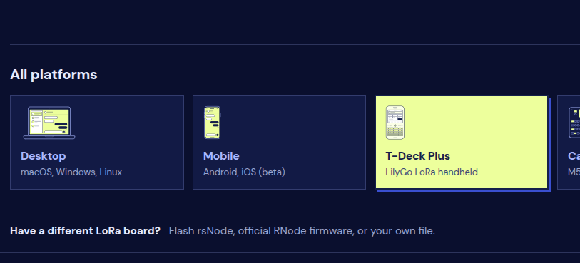
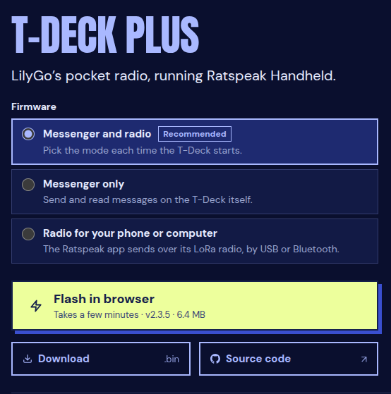
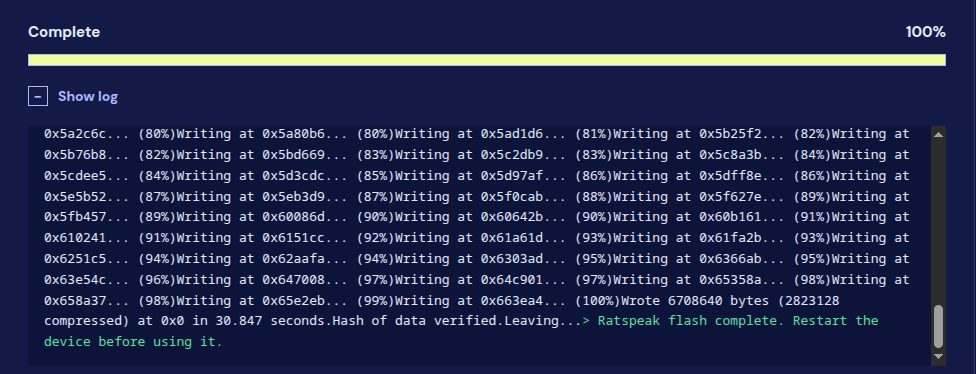

# Flash Ratspeak Handheld on T-Deck Plus

Use this procedure to install **Ratspeak Handheld** on a **LilyGO T-Deck Plus**.
Current firmware comes from the unified
[ratspeak-handheld releases](https://github.com/ratspeak/ratspeak-handheld/releases).
The older rsDeck releases have different layouts and their own recovery
instructions.

## Before you start

Use Chrome or Edge on a computer and a USB data cable. Attach a suitable LoRa
antenna before transmitting. Close other applications using the serial port.

[Back up an existing handheld](/docs/hardware/flashing-firmware#back-up-an-existing-handheld)
before changing firmware. Compatible web updates preserve identity, settings
and messages, but an unidentified or incompatible installation may require
**Erase and install**. Cancel if the data is not backed up.

## Install with the browser

1. Open the [Ratspeak download page](https://ratspeak.org/download.html#tdeck)
   with **T-Deck Plus** selected. Under **Firmware**, choose a package, then
   select **Flash in browser**.

   

2. Check the version and package. **Messenger and radio** (Full) includes the
   Standalone messenger, RNode radio mode, and a startup launcher. **Messenger
   only** (Standalone) and **Radio for your phone or computer** (RNode) install
   only the selected mode.

   

3. Connect USB. If the flasher cannot connect normally, switch the main power
   off, hold the trackball button, switch the power on and release the button
   after a few seconds. The screen may stay black in download mode.
4. Choose **Select USB device** and select the board's serial port.
5. Select **Install Ratspeak**. Read the device check and any installation notice.
   Keep the cable connected and tab open until the flasher reports completion.

   

6. Restart the T-Deck if needed. A Full installation opens the mode launcher;
   choose Standalone to use the on-device messenger.

For a downloaded or locally built image, open the
[advanced flasher](https://ratspeak.org/flash.html) and use its **Upload** tab.
Use the complete `tdeck-full.bin`, `tdeck-standalone.bin`, or `tdeck-rnode.bin`.
The upload action is labelled **Install firmware**. The `tdeck-standalone-launcher.bin` is for
[bmorcelli's Launcher](/docs/hardware/flashing-firmware#bmorcellis-launcher),
not this procedure.

## Check the installation

In Standalone, check the name, timezone and radio settings. Announce and exchange
a message with a known peer. In RNode mode, connect the host and configure its
[RNode interface](/docs/networking/lora-and-rnode); the host supplies the radio
settings.

If the board does not start, record the displayed error and chosen image before
reflashing. See [download mode and recovery](/docs/hardware/flashing-firmware#recovery-download-mode)
and the [handheld guide](/docs/hardware/handheld-guide).
